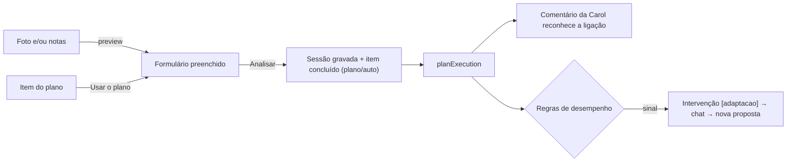

# Plano v2 — Registo unificado ligado ao plano da Carol

Decisões fechadas a 2026-10-06:

| # | Decisão |
|---|---|
| 1 | "Meta" = **objetivo de cada exercício** |
| 2 | Formulário único em **todos** os registos (Ginásio, Corrida, Refeição, Corpo): experiência uniforme |
| 3 | Treino livre num dia com item pendente **marca como feito**, mas a Carol **NÃO altera o plano sozinha**: abre intervenção, chama o atleta ao chat e **propõe** a adaptação necessária |
| 4 | Campos de cardio (tempo / km / voltas) **dependem do exercício** |
| 5 | A Carol **não prescreve kg**: séries × reps + meta; o peso vem da última execução |
| 6 | **Opção A para fotos:** Upload ➔ Leitura/Preview ➔ Formulário editável preenchido ➔ Atleta revê ➔ Analisar e Guardar |
| 7 | **Armário de Exercícios (`athlete_exercises`):** catálogo pessoal sem favoritos manuais — basta ter sido registado 1 vez para ficar guardado com última carga, reps e regulação |
| 8 | **Modo Live no Ginásio:** pontos de entrada claros: **Início** ("Começar Treino") e **FAB global** ("Novo treino"), abrindo logo o plano para picar séries durante a sessão |

---

## 0. O que já existe e se reaproveita

- **Fotos + notas → dados estruturados já funcionam.** No modo foto, o `analyze-gym` junta prints e observação num só pedido e devolve exercícios → séries → reps/kg ([buildPrompt](file:///c:/Users/rpmar/IronHealth-antigravity/supabase/functions/analyze-gym/index.ts#L160-L206)). Faltava o modo `preview` (Opção A) para não gravar logo e permitir rever.
- **A Refeição já segue o padrão pedido**: fotos e alimentos convivem, com um só "Analisar refeição". É o modelo base.
- **A Despensa (`athlete_foods`)**: modelo idêntico ao que aplicaremos ao Armário de Exercícios (`athlete_exercises`).
- A ligação item ↔ registo (`completed_session_id` / `completed_run_id`) e a persistência de rascunhos em background (`usePersistedFormDraft`).

---

## 1. Padrão único de registo (os 4 módulos)

Uma só estrutura, com o mesmo aspeto e a mesma ordem em todos:

```
┌ Cabeçalho (módulo · Novo/Editar · fechar)
├ Do plano (só se houver item pendente nesse dia)   ← Ginásio, Corrida, Refeição
├ Data · Hora
├ Ler de uma foto (opcional) → preenche os campos   ← todos
├ Campos do módulo (sempre visíveis)
│   Ginásio: exercícios → objetivo + séries (força) ou tempo/km/voltas (cardio)
│   Corrida: tipo, distância, duração, objetivo, métricas
│   Refeição: alimentos + gramas (já é assim)
│   Corpo: medições
├ Observações
└ ActionBar: "Analisar" (uma só ação)
```

Componentes partilhados em `src/components/shared/registration/`:
- `RegistrationShell` (cabeçalho, guarda de saída, rascunho, confirmação)
- `PlanPrefillBanner`
- `PhotoReadSection` (escolher fotos → "Ler" → pré-visualização → aplicar)
- `ExerciseEditor` (Ginásio)

> [!NOTE]
> **Proposta para a Refeição:** o plano já tem `meal_macros.meal_items`, as refeições sugeridas pela Carol. O mesmo banner ("Vais registar a refeição sugerida?") pré-carregava esses alimentos. Mesma experiência do treino. No Corpo não há plano, por isso não há banner.

---

## 2. Modelo de dados (Fase 0)

### 2.1 Prescrição no plano
`coach_plan_items.prescription jsonb`:
```json
{ "blocks": [
  { "type": "forca",  "name": "Seletor de pernas",   "sets": 3, "reps": 12, "goal": "controlar a descida em 3 s" },
  { "type": "forca",  "name": "Extensões de pernas", "sets": 3, "reps": 12, "goal": "chegar às 12 sem falhar" },
  { "type": "cardio", "name": "Bicicleta", "fields": ["duration", "distance"], "duration_min": 20, "goal": "Z2, cadência 85-90" }
]}
```
- **Sem `weight_kg`** (decisão 5).
- `fields` diz que campos de cardio se mostram para aquele exercício (decisão 4).
- Sem `minItems`/`maxItems` nos arrays aninhados: é o bug de 400 do Gemini (spec §9). A validação faz-se em código.

### 2.2 Execução no registo
- `workout_sessions.exercises_meta jsonb`: `[{ name, goal, block_type, plan_block_index, goal_met }]`. O **objetivo vive por exercício, não por série**. Assim não se mexe na forma de `workout_session_sets`, que muitas leituras usam.
- `workout_session_sets`: + `duration_seconds`, `distance_km`, `laps` (nullable), para as linhas de cardio.
- `runs.goal text`: o objetivo da corrida (uma corrida é "um exercício").

### 2.3 Origem da ligação (decisão 3)
- `coach_plan_items.completion_source text`: `'plano'` (escolheu "Usar o plano" ou veio de "Registar sessão") ou `'auto'` (treino livre que riscou o item do dia).

### 2.4 Catálogo de cardio (decisão 4)
`src/utils/cardioFields.js`, também espelhado em `_shared`: exercício → campos por omissão.

| Exercício | Campos |
|---|---|
| Bicicleta, passadeira, elíptica | tempo, km |
| Remo | tempo, metros |
| Piscina | tempo, voltas |
| Corda, burpees, outros | tempo, voltas/rondas |
| Desconhecido | tempo + botão "+ km / + voltas" |

Corrida: as voltas só aparecem em `intervalos` (pista).

### 2.5 O Armário de Exercícios (`athlete_exercises` — decisão 7)
Catálogo pessoal de exercícios do atleta — qualquer exercício registado ou executado fica guardado com a sua última carga e repetições:
```sql
create table if not exists public.athlete_exercises (
  id uuid primary key default gen_random_uuid(),
  user_id uuid not null references auth.users(id) on delete cascade,
  name text not null,
  name_key text not null, -- normalizado (lowercase, sem acentos)
  category text not null, -- grupo muscular (Pernas, Peito, Costas, etc.)
  block_type text not null default 'forca' check (block_type in ('forca', 'cardio')),
  cardio_fields text[] default null, -- ['duration', 'distance', 'laps']
  machine_settings text, -- afinações pessoais ("banco furo 3, pino 6")
  last_weight numeric,
  last_reps integer,
  personal_record_weight numeric,
  times_performed integer not null default 1,
  last_performed_at timestamptz,
  created_at timestamptz not null default now(),
  updated_at timestamptz not null default now(),
  unique (user_id, name_key)
);
```

---

## 3. Fases

### F0 — Dados e ferramenta da Carol
- Migrações aditivas (§2, incluindo `athlete_exercises`), espelhadas em `supabase_schema.sql`, revistas pela supabase_guardian.
- O `PROPOSE_PLAN_TOOL` aceita `prescription` (com `goal` por bloco). Validação em código. O teste estrutural dos arrays aninhados tem de passar.
- Doutrina [03-ginasio.md](file:///c:/Users/rpmar/IronHealth-antigravity/src/coach-knowledge/03-ginasio.md): prescrever séries × reps + objetivo; nunca kg.

### F1 — Formulário único + Registo Live no Ginásio (Ginásio → Corrida → Corpo)
- Remover o `entryMethod` em [GymRegistration.jsx](file:///c:/Users/rpmar/IronHealth-antigravity/src/components/Gym/GymRegistration.jsx), [RunRegistration.jsx](file:///c:/Users/rpmar/IronHealth-antigravity/src/components/Run/RunRegistration.jsx) e [BodyRegistration.jsx](file:///c:/Users/rpmar/IronHealth-antigravity/src/components/Body/BodyRegistration.jsx).
- Ginásio: o `ExerciseEditor` passa a estar disponível **na criação** (com campo "Objetivo" por exercício).
- Suporte a **Registo Live**: botões de check de série concluída `[ ✓ ]`, ajuste rápido de peso/reps, e botão "+ Adicionar do Armário" com pesquisa instantânea por grupo muscular.
- `analyze-gym` em `mode: "manual"` sem `session_id` passa a aceitar `sets` + `exercises_meta` + fotos opcionais, e atualiza o histórico do `athlete_exercises`.
- O rascunho (`usePersistedFormDraft`) protege a sessão live mesmo com ecrã desligado ou saídas para o Spotify.

### F2 — Ler foto/notas para o formulário (Opção A)
- `mode: "preview"` em `analyze-gym`, `analyze-run` e `analyze-body`: **o mesmo prompt de hoje** (fotos + notas), mas **não grava**. Devolve os dados estruturados para o formulário.
- Funciona **também só com notas**: "3x12 extensões 40kg, 20 min bike" → linhas estruturadas no formulário.
- O atleta revê, corrige e prime "Analisar e Guardar".
- Recebe a prescrição do item escolhido para fazer corresponder nomes ("Leg Extension" → "Extensões de pernas") e `plan_block_index`.

### F3 — Pré-preenchimento pelo plano
- `findPendingPlanItems(kind, date)`. Banner: 0 itens → nada; 1 → já escolhido; vários → escolher. Vindo de "Registar sessão" → ligado, sem banner.
- "Usar o plano": por bloco de força, N séries com as reps alvo e o **kg da última execução** desse exercício ("da última vez: 40 kg × 10"); objetivo preenchido. Por bloco de cardio, os campos de `fields`.
- "Treino livre": campos vazios. Ao gravar, o item do dia é riscado na mesma, com `completion_source='auto'`.

### F4 — Planeado vs feito + a Carol reconhece
- `_shared/formulas/planExecution.ts` + golden: séries e reps cumpridas por bloco, carga face à última vez, `goal_met`, exercícios trocados/em falta/extra, `completion_source`.
- **Decisão 3 na prática:** quando `completion_source='auto'`, o comentário da análise começa por reconhecer isso, por exemplo: *"Registaste como treino livre; contei-o como o treino de pernas do plano de hoje. Fizeste extensões e bicicleta, ficou de fora o seletor."* O mesmo facto entra no `buildPlanContext()` do chat e no resumo diário.
- `coach_plan_items.execution_note`: a nota da Carol sobre a execução, gravada pela análise.
- `WeeklyPlanCard`: o item concluído mostra "Planeado / Feito" e o selo "ligado automaticamente" quando for o caso.

### F5 — Adaptação proativa
- Motivo `desempenho_vs_plano`, com regras sobre o `planExecution`: progredir (tudo cumprido + RPE ≤ 7, 2 vezes seguidas), aliviar (< 80 % das reps ou RPE ≥ 9), trocar (exercício saltado ou substituído 2 vezes), cardio abaixo do alvo 2 vezes, objetivo falhado 2 vezes.
- Intervenção `[adaptacao]` → Início + push `plan_adaptation` → chat → `propose_training_plan` com `supersedes_plan_id` → o atleta aceita ou recusa. Nunca se edita um plano aceite em silêncio.
- No máximo uma por plano e por semana; assinatura como em `planDivergence`.



---

## 4. Ordem e riscos

| Ordem | Entrega | Risco / cuidado |
|---|---|---|
| 1 | F0 | As Edge Functions vão para produção em cada push para `dev`: migração primeiro, campos opcionais |
| 2 | F1 Ginásio | Ficheiro com 1140 linhas: extrair componentes antes de mexer |
| 3 | F2 Ginásio | Não regredir o modo foto atual (o caminho que já funciona) |
| 4 | F3 + F4 | Só têm valor com planos novos que tragam `prescription`; os planos antigos caem no prefill atual |
| 5 | F1/F2 Corrida, Corpo, alinhar Refeição | `RunRegistration.jsx` tem 3180 linhas: é o maior risco de regressão |
| 6 | F5 | Afinar limiares com dados reais antes de ligar o push |

**Transversal:** spec `specs/registo-unificado-plano.md` (spec_writer); atualizar `plano-de-treino.md` §3.2/§5.2/§5.4, o PRD e o manual (docs_keeper); testes Vitest (shell, banner, preview merge, editor) e Deno (validação da prescrição, preview sem gravação, golden de `planExecution`); auditoria a11y (touch ≥ 44 px no editor de séries).

---

## 5. Modelos de IA recomendados por fase

Dividido em duas vertentes: **Modelos na Aplicação (Runtime/Produção)** e **Modelos no Antigravity (Desenvolvimento/Coding)**.

### 5.1 Modelos na Aplicação (Edge Functions / Backend)

| Fase | Funcionalidade | Modelo Recomendado | Justificação |
|---|---|---|---|
| **F0 / Chat** | Proposta de plano estruturado (`PROPOSE_PLAN_TOOL`) | **Gemini 2.5 Pro** | Raciocínio desportivo complexo e cumprimento rigoroso do schema JSON aninhado (zero alucinações na prescrição). |
| **F1 / F4** | Análise e comentário final do treino (`analyze-gym`) | **Gemini 2.5 Flash** (com thinking) | Latência rápida (< 3s), tom pedagógico empático e bom cruzamento do histórico. |
| **F2** | Leitura/Preview de Prints e Notas (`mode: "preview"`) | **Gemini 2.5 Flash** (sem thinking / Flash-Lite) | Leitura multimodal de alta velocidade e baixo custo para uma etapa intermédia de revisão antes da gravação. |
| **F4 / F5** | Comparação planeado vs feito e regras de adaptação | **Nenhum (Código TS Determinístico)** | Doutrina IronCoach: métricas críticas e regras de desvio vivem em fórmulas determinísticas (`planExecution.ts`), com custo zero e zero alucinações. |
| **F5** | Conversa no chat sobre a adaptação do plano | **Gemini 2.5 Pro** | Diálogo persuasivo, contextualizado nas sensações do atleta e no histórico recente. |

### 5.2 Modelos no Antigravity (Durante o Desenvolvimento)

| Fase | Tarefa de Código | Modelo Ideal no Chat | Motivo |
|---|---|---|---|
| **Fase 0** | Migrações SQL, RLS, integridade de schema e Edge Functions | **Claude Opus 5.5 / Claude 3.7 Sonnet** | Rigor absoluto em PostgreSQL, regras RLS de segurança e contratos de tipos Deno/TS. |
| **Fase 1** | Refatoração UI em React, Modo Live, Touch targets ≥ 44px e A11y | **Claude Opus 5.5** | `GymRegistration.jsx` tem 1140 linhas; exige máxima precisão contextual para modularizar sem introduzir regressões. |
| **Fase 2** | Prompts de visão multimodal, mockups e integração de preview | **Gemini 3.8 Flash / Pro** | Rápido a iterar prompts de visão e formatação estruturada de respostas. |
| **Fase 3 & F4** | Fórmulas determinísticas, golden tests `.golden.json` e catálogo | **Claude Opus 5.5 / Gemini 3.8 Pro** | Raciocínio puro e rigor matemático para bater 100% dos testes unitários. |
| **Fase 5** | Intervenções, push ticks e regras de antispam | **Claude Opus 5.5** | Concorrência, gestão de estado global e orquestração de subagentes. |

---

## 6. Estado e decisões de 2026-10-18

**Feito e em `master` (fc97cadf):** F0, F1 e F2 (Ginásio), F3, F4 — com três rondas de revisão pré-deploy (a última 🟢).

| # | Decisão |
|---|---|
| 9 | **`goal_met` misto:** a Carol infere-o quando o objetivo é mensurável (reps, tempo, km, ritmo); nos qualitativos ("descida em 3 s") o atleta confirma com um toque. **Feito (2026-10-19):** `_shared/formulas/goalCheck.ts` (reps, minutos, km, metros, ritmo; qualquer resto ⇒ qualitativo) julga-o ao ler a execução, sempre fresco; o registo mostra "Cumpriste o objetivo? Sim/Não" só nos qualitativos |
| 10 | **Afinação (`machine_settings`)** escreve-se no registo, por exercício, e aparece da próxima vez; também editável no Armário |
| 11 | **"Começar treino" só no Início** (não no FAB), quando há treino de ginásio no plano do dia — abre o registo já com "Usar o plano" |
| 12 | **`RegistrationShell`** faz-se com o Corpo (o registo mais pequeno), antes da Corrida |
| 13 | **Ordem:** Corpo → Refeição → Corrida → F5 → documentação |
| 14 | **Armário com submenus:** Treino (o Armário de Exercícios — hoje sem ecrã), Alimentação (a Despensa: alimentos, como cozinhas, refeições) e Equipamento (as sapatilhas) |
| 15 | **Refeição só com observações:** escrever o que se comeu e analisar, sem alimentos nem fotos — a Carol estrutura os alimentos e calcula |
| 16 | **Imagens no chat da Carol:** fotos de embalagens e de alimentos, enviadas na conversa. **Feito (2026-10-19):** botão de anexar no chat (até 3 fotos, JPEG comprimido, só em memória); vão no pedido ao `coach-chat` (`images`), que as passa ao Gemini e não as guarda — no histórico fica "📷 N fotos enviadas" |
| 17 | **Embalagem no chat → Despensa:** quando o atleta manda a foto de uma embalagem, a Carol lê o rótulo e guarda o alimento na Despensa (como já faz com um rótulo numa refeição), e diz-lho na resposta. **Feito (2026-10-19):** ferramenta `save_pantry_food` (só declarada com fotos no pedido): a Carol lê a tabela e grava em `athlete_foods` (`source='rotulo'`, `in_pantry`, sem contar como refeição) por `nextFoodRow`; não reescreve o que o atleta ajustou; valores incoerentes são recusados. Comida preparada: comenta e estima, não guarda. Num turno com fotos a Carol só pode ler, guardar notas e usar a Despensa (nunca mexer em planos, metas ou provas: o texto de uma imagem não são instruções); a energia do rótulo só é recusada se destoar grosseiramente dos macros, com crédito para fibra, polióis e álcool |
